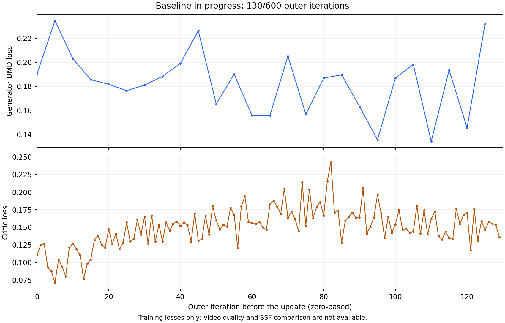

# Baseline 实验中间结果

状态：**仍在训练，尚未完成**。本页是 `2026-10-26T23:25:05.105243+08:00` 的固定快照，不代表之后的实时进度。

| 项目 | 观测值 |
|---|---|
| 运行 ID | `20261026_131447_9d70a298` |
| 训练源码 | [`99ef714`](https://github.com/helloworld-maker-create/SSF/commit/99ef714ea2572ec8c666b8bf2d19c780fe2c6a7f) |
| 启动时间（北京时间） | 2026-10-26T13:14:59.252658+08:00 |
| 设备 | 0009，4 × H100 80GB |
| 已完成 outer | **130 / 600（21.67%）** |
| G / C 已接受更新 | **26 / 130** |
| 每 rank 已接受更新条数 | 156，4 个 rank 一致 |
| G / C 有效 batch | 64 / 64（每 rank microbatch 1，累积16次） |
| 已接受全局训练样本数 | 9984（包含G与C两类更新，不是唯一prompt数） |
| EMA | 尚未初始化；配置在 outer200 初始化 |
| 完整 checkpoint / 生成视频 | 0 / 0；首个例行保存/监控点为 outer200 |
| 运行状态 | 4 个 worker 均存活，当前日志无致命 traceback |

## 损失记录

下表均来自原生训练的全局 batch 均值。G 与 C 是不同目标，不能互相比较数值大小；训练 loss 的变化也不代表视频质量改善。

| 目标 | 更新次数 | 首次 | 最近一次 | 全程均值 | 前10次均值 | 最近10次均值 |
|---|---:|---:|---:|---:|---:|---:|
| G（原生DMD） | 26 | 0.190333 | 0.231813 | 0.183051 | 0.196603 | 0.176477 |
| C（critic） | 130 | 0.110325 | 0.136353 | 0.150228 | 0.101227 | 0.150208 |

G 最近10次均值低于最初10次，C 最近10次均值高于最初10次；两者都有波动。目前只能确认训练已持续接受更新，**尚不能判断收敛或生成质量**。没有 SSF 对照结果，也没有 VBench/人工评分。

已发布记录中的损失和裁剪前梯度范数均为有限值；每次更新记录的根 clip / optimizer step 均各1次、全局样本64、累积梯度为FP32。四个rank记录的全局loss、计数、cursor与clip范数一致。这是运行观测，不冒充额外的专项资格验证；本次使用用户要求的直接启动模式。

## 耗时与当前限制

本次已运行约 **10.17 小时**。按已完成轮数简单线性外推，600轮约需 **46.9 小时**，尚未计入后续 checkpoint / 视频监控额外成本；这不是完成时间保证。

当前 `wall_hours=24`，对应约 `2026-10-27T13:14:59.252658+08:00`。以当前速度，24小时内预计无法完成600轮；程序会在达到时限后的完整outer边界尝试保存 emergency checkpoint 并退出。本次发布未修改运行参数、延长时限、暂停或重启训练。

## 可下载的记录

- [机器可读摘要](snapshots/20261026_232505/summary.json)
- [四个rank的逐更新CSV](snapshots/20261026_232505/updates.csv)（全局均值在rank之间重复，绘图仅取rank0，不能当作4次独立实验）
- [原始 rank0 JSONL.gz](snapshots/20261026_232505/raw/updates_rank0.jsonl.gz)、[rank1](snapshots/20261026_232505/raw/updates_rank1.jsonl.gz)、[rank2](snapshots/20261026_232505/raw/updates_rank2.jsonl.gz)、[rank3](snapshots/20261026_232505/raw/updates_rank3.jsonl.gz)
- [训练配置](snapshots/20261026_232505/training_config.json)、[包版本](snapshots/20261026_232505/environment.json)、[rank0日志尾部](snapshots/20261026_232505/train_rank0_tail.log)
- [来源、文件字节数与SHA256](snapshots/20261026_232505/manifest.json)、[损失图复现脚本](snapshots/20261026_232505/plot_loss.py)

快照只截取各rank共有、截至完整outer130的已接受更新前缀。之后正在计算或刚接受的下一轮工作不纳入本页；原始JSONL gzip解压后保留该前缀的原始字节。配置中的机器绝对路径转为文件角色名，禁用的WandB字段省略。当前尚无完整权重/视频结果，本次Git提交只包含日志、数值、图和元数据。
